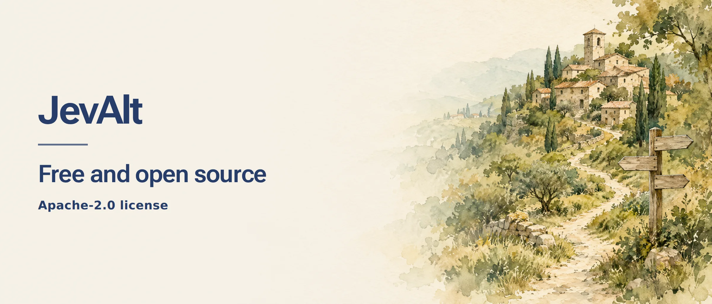

<p align="center"></p>

<p align="center">
  <a href="https://github.com/mertkayacs/jevalt"></a>
  <a href="https://huggingface.co/mertkayacs/Deem-4B"></a>
  <a href="https://huggingface.co/mertkayacs/Karar-4B"></a>
  <a href="https://huggingface.co/mertkayacs/Wahler-4B"></a>
  <a href="LICENSE"></a>
  
</p>

JevAlt is free and open source under the Apache-2.0 license.

<p align="center"><b>Three 4B open-weights language models choose between options and return a probability for each, for routing, policy checks and typed decisions on your own hardware.</b></p>

Give JevAlt a situation, a question and answer options. Its three 4B language models choose between the options and return a probability for each, for tasks such as routing support tickets or checking a written policy. They run locally so these decisions can be inspected and tested on your own data.

<a href="https://emberwick.mertkayacs.com"><picture><source media="(prefers-reduced-motion: reduce)" srcset="https://raw.githubusercontent.com/mertkayacs/jevalt/main/docs/assets/emberwick-barn-fire-en.webp"></picture></a>

[Try an example](https://huggingface.co/spaces/mertkayacs/JevAlt) or run a model below.

## Try it

The [Hugging Face Space](https://huggingface.co/spaces/mertkayacs/JevAlt) includes seven examples. These are Deem-4B's recorded English answers from 1 October 2026:

| Use case | Question | Answer |
| --- | --- | --- |
| Support ticket | Which team should handle this ticket? | **Billing** 94.8% |
| Outage | How severe is this incident? | **Critical** 87.6% |
| Sales lead | How should sales treat this lead? | **Hot** 92.3% |
| Return window | Is this return within the 14-day window? | **No** 97.9% |
| Phishing email | Where should this email go? | **Quarantine** 94.3% |
| Missing information | Which room type did the guest book? | **unknown** 97.6% |
| Village fire | What should Mirka do next? | **Help with the fire** 66.0% |

The English, Turkish and German requests and probability distributions are in [`space-examples.json`](https://huggingface.co/datasets/mertkayacs/jevalt-bench/blob/main/results/examples/space-examples.json).

## Run locally

Requires Python 3.11 or newer. The Q4_K_M GGUF builds run on a CPU in about 3 GB of RAM; a GPU is optional.

```sh
pip install "jevalt[serve,gguf] @ git+https://github.com/mertkayacs/jevalt" && jevalt serve
```

This downloads Deem-4B and starts a server at `http://127.0.0.1:8000`. In another terminal, send a support ticket:

```sh
curl -s http://127.0.0.1:8000/v1/systemone -H 'Content-Type: application/json' -d '{"state":"I was charged twice for March. Please refund the duplicate.","questions":{"team":{"type":"choice","instructions":"Which team should handle this ticket?","criteria":{"billing":"payments, refunds","technical":"bugs, outages","sales":"prices, contracts"}}}}'
```

The server implements the Jev API (`POST /v1/systemone`), so existing Jev clients can use it. [API and configuration docs](https://mertkayacs.github.io/jevalt/) cover question types, optional reasoning and the `unknown` answer.

## Models and results

| Model | Language | Weights | GGUF for CPUs |
| --- | --- | --- | --- |
| Deem-4B | English | [mertkayacs/Deem-4B](https://huggingface.co/mertkayacs/Deem-4B) | [mertkayacs/Deem-4B-GGUF](https://huggingface.co/mertkayacs/Deem-4B-GGUF) |
| Karar-4B | Turkish | [mertkayacs/Karar-4B](https://huggingface.co/mertkayacs/Karar-4B) | [mertkayacs/Karar-4B-GGUF](https://huggingface.co/mertkayacs/Karar-4B-GGUF) |
| Wähler-4B | German | [mertkayacs/Wahler-4B](https://huggingface.co/mertkayacs/Wahler-4B) | [mertkayacs/Wahler-4B-GGUF](https://huggingface.co/mertkayacs/Wahler-4B-GGUF) |

All three start from [Intern-Decision-4B](https://huggingface.co/internlm/Intern-Decision-4B). Accuracy on held-out decisions:

| Model | Language | Accuracy | Kev-4B |
| --- | --- | ---: | ---: |
| [Deem-4B](https://huggingface.co/mertkayacs/Deem-4B) | English | 94.7% | 84.7% |
| [Karar-4B](https://huggingface.co/mertkayacs/Karar-4B) | Turkish | 96.8% | 87.1% |
| [Wähler-4B](https://huggingface.co/mertkayacs/Wahler-4B) | German | 92.0% | 81.1% |


These tests come from JevAlt's own data pipeline and favour JevAlt. [Results and evaluation records](https://huggingface.co/datasets/mertkayacs/jevalt-bench/tree/main/results/comparison) include calibration scores and comparisons with Laya and the starting checkpoint.

To serve Turkish:

```sh
jevalt serve --model mertkayacs/Karar-4B-GGUF --file Karar-4B-Q4_K_M.gguf
```

## Tested on the live models

The three live models received 390 requests across five cases, 130 per language, on 4 October 2026. Every request and answer is in [`results/tested`](https://huggingface.co/datasets/mertkayacs/jevalt-bench/tree/main/results/tested).

Deem-4B answered 122 of 130 English requests correctly:

| Case | Requests | Result |
| --- | --- | --- |
| Planted instructions | 30 phishing emails with a planted line, plus the same 10 without it | 26 of 30 quarantined; 10 of 10 without the line |
| Long policies | 20 customers evaluated against one six-rule return policy | 17 of 20 matched the answer computed from the rules |
| Negations | 15 facts asked in plain and negated forms | 29 of 30 correct |
| Missing facts | 10 situations missing a deciding fact, plus the same 10 with it | 10 of 10 returned `unknown`; 10 of 10 correct with the fact |
| Casual messages | 20 messages with typos and slang | 20 of 20 routed to the intended team |

<details>
<summary><b>Turkish and German live tests</b></summary>

Karar-4B answered 113 of 130 Turkish requests correctly:

| Case | Result |
| --- | --- |
| Planted instructions | 22 of 30 quarantined; 7 of 10 without the line |
| Long policies | 16 of 20 matched the answer computed from the rules |
| Negations | 29 of 30 correct |
| Missing facts | 10 of 10 returned `unknown`; 10 of 10 correct with the fact |
| Casual messages | 19 of 20 routed to the intended team |

Wähler-4B answered 122 of 130 German requests correctly:

| Case | Result |
| --- | --- |
| Planted instructions | 28 of 30 quarantined; 10 of 10 without the line |
| Long policies | 14 of 20 matched the answer computed from the rules |
| Negations | 30 of 30 correct |
| Missing facts | 10 of 10 returned `unknown`; 10 of 10 correct with the fact |
| Casual messages | 20 of 20 routed to the intended team |

</details>

## Training

The released models use rank-32, alpha-32 LoRA on the bf16 weights of Intern-Decision-4B, trained on one A100 80 GB. A shared multilingual epoch used 17,363 rows over 543 steps. Each language model then ran one specialization epoch: Deem-4B used 7,783 rows over 303 steps, Karar-4B 5,982 rows over 281 steps, and Wähler-4B 5,384 rows over 210 steps.

The release came from 11 training jobs, including smoke runs, a pilot, the shared run and three language runs. The released training runs used about 2.7 A100 hours. The full project, including labeling, cost 32.2 USD. The loss matches each option probability to a soft label, with a lower-weight language-model loss for short reasoning traces.

## Limits

- Confidence is calibrated on held-out project data, so the probabilities are fitted to match how often the model is right on that data. Refit calibration on your own data with [JevOss](https://github.com/mertkayacs/jevoss) before setting decision thresholds.
- Long, noisy text and date calculations remain weak spots. Kev-4B and Laya lose less accuracy under long padding; the starting checkpoint leads on JevBench-hard.
- The models still follow some hidden instructions planted in input text. Test this behaviour before using their answers to trigger actions.

See the [reasoning study](https://mertkayacs.github.io/jevalt/reasoning/) and [JevOss failure analysis](https://github.com/mertkayacs/jevoss/blob/main/docs/problems.md) for methods and limits. Separate [live tests](https://huggingface.co/datasets/mertkayacs/jevalt-bench/tree/main/results/tested) cover 390 requests across the three languages.

## Cite this

```bibtex
@software{kaya2026jevalt,
  author = {Mert Kaya},
  title = {JevAlt: Open Decision Models with the Jev API},
  year = {2026},
  license = {Apache-2.0},
  url = {https://github.com/mertkayacs/jevalt},
  version = {0.1.0}
}
```

## Data, training and demos

- [Training data](https://huggingface.co/datasets/mertkayacs/jevalt-data) and [benchmark data](https://huggingface.co/datasets/mertkayacs/jevalt-bench).
- [Training and export code](training/) for fine-tuning, evaluation and GGUF conversion.
- [Emberwick](https://emberwick.mertkayacs.com): play a village simulation whose inhabitants' actions are chosen by these models.
- [Project site](https://jevalt.mertkayacs.com) for model pages and demonstrations.
- [Eschatia Labs](https://eschatialabs.com) · [Mert Kaya](https://mertkayacs.com)

## Reproduce

- [`training/mix.py`](training/mix.py) composes the training mix from canonical JSONL files.
- [`training/train.py`](training/train.py) runs LoRA fine-tuning with gradient checkpointing.
- [`training/cards.py`](training/cards.py) builds model cards from measured results.
- [`training/jobs/evaluate.py`](training/jobs/evaluate.py) evaluates a checkpoint or adapter with Transformers.
- [`training/jobs/eval_http.py`](training/jobs/eval_http.py) evaluates a running `/v1/systemone` server.
- [`training/jobs/export.py`](training/jobs/export.py) merges adapters, creates GGUF files, quantizes them and checks parity.
- [`training/jobs/bakeoff.py`](training/jobs/bakeoff.py) evaluates candidate base checkpoints on the same suites.

## License

Code and weights: [Apache-2.0](LICENSE). JevAlt is independent of TypeSafe AI; Jev is a TypeSafe AI model.

## Acknowledgements

JevAlt starts from [Intern-Decision-4B](https://huggingface.co/internlm/Intern-Decision-4B), released under Apache-2.0. The API follows TypeSafe's public `/v1/systemone` specification. JevAlt is an independent project with no affiliation to TypeSafe AI.

<a href="https://eschatialabs.com"><picture><source media="(prefers-color-scheme: dark) and (min-resolution: 2dppx)" srcset="https://eschatialabs.com/brand/lockup-46-dark@2x.png"><source media="(prefers-color-scheme: dark)" srcset="https://eschatialabs.com/brand/lockup-46-dark@1x.png"><source media="(min-resolution: 2dppx)" srcset="https://eschatialabs.com/brand/lockup-46@2x.png"></picture></a><br>An [Eschatia Labs](https://eschatialabs.com) project by [Mert Kaya](https://mertkayacs.com).
